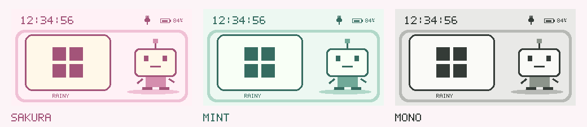

# Rainy75 V2 工具箱（桌面版）· 社区二次开发

> **本仓库是什么**：在 [xixiaotiam1219-lab/rainy75v2-tft](https://github.com/xixiaotiam1219-lab/rainy75v2-tft)（MIT，© 2026 xixiaotiam1219-lab）基础上做的一个 **Windows 桌面工具箱** 分支：把「刷机向导 + 主题定制台 + 显示诊断」装进一个可双击运行的 exe，并补上了日常只换配色/动画/校时的快捷流程、连接方式图标、S1 上传自修复等。
>
> **v1.2.0 起软件重新自带固件包**（`inputs/` + `toolbox/firmware/` + clang），双击打开就能 ①→⑥ 直接刷，不用再自己去导 `ips-stock.bin`、也不用另外装编译器。
>
> **歌词播放器扩展已整体移除**：没有字库上传、没有 Windows 常驻后台、没有 `Ctrl + F8` 切页。屏幕只做按键页、时钟、电量、连接图标和机器人动画，全部在屏内本地运行。

---

## 快速开始

1. 到 [Releases 页](https://github.com/INDULGE00/rainy75v2-toolbox/releases) 下载 `Rainy75Toolbox-full.exe`（约 100 MB）双击运行，无需 Python、无需联网。
2. 首次启动会把内置组件释放到 `%LOCALAPPDATA%\Rainy75Toolbox\app`（约 5 秒），之后秒开。
3. 到「刷机向导」按 ① 预检 → 勾选 4 项确认 → ①→⑥ 完整刷一次：主控 IAP → 烧主控 → 屏幕 IAP → 烧屏幕 → 上传 S1 → 校时。
4. 之后只想换配色 / 换动画 / 校时，用向导里的 **快捷操作** 即可，不必从头刷。

刷机必须 **USB 数据线直连键盘本体 + 有线档**；2.4G / 蓝牙刷不了屏。**刷机有风险**，先读 [免责声明](DISCLAIMER.md) 与 [恢复指南](docs/recovery.md)。

---

## 内置固件包是什么

| 内容 | 位置 | 说明 |
| --- | --- | --- |
| 内置快照（刷机向导默认用它） | `toolbox/firmware/` | 主控 `main.bin` 294,912 B（**官方 0.64 基线**）· 屏幕 `ips.bin` 507,904 B · S1 动画 · `info.json` |
| 原厂编译输入 | `inputs/` | `ips-stock.bin`、`main-stock.bin`（官方 0.64）、`main-stock-063beta1.bin`（旧 0x3F）、`libISP585.a`，`build.py` 逐个核对 SHA-256 |
| 原厂离线烧录网页 | `vendor/` | 内嵌键盘 `0x3F`、接收器 `0x26`、屏幕 `0x0002`，用于提取输入与救砖 |
| 编译器 | exe 内 / `llvm/bin/` | `full` 版自带 clang + lld，定制台可以重新编译主题 |

向导里「固件来源」三个选项：

| 选项 | 读哪里 | 说明 |
| --- | --- | --- |
| **内置快照（推荐）** | `toolbox/firmware/` | 已验证可用的那套固件，离线可刷 |
| build/ 最新编译 | `build/main`、`build/ips` | 定制台刚重编完想直接刷时选这个 |
| 自选本地文件 | 你磁盘上的 `.bin` / `.gif` | 留空的项目自动回落为内置快照 |

> **主控必须按官方 0.64 基线编译**：向导的严格预检只认 `stockSha256 = 31a9eb80…` / `stockVersion = 0.64`。
> 如果你的键盘是官方 0.64 却拿 0x3F 编的固件去刷，会报「主控基线不是官方 0.64，拒绝刷写」；反之亦然。
> 仓库里的 `inputs/main-stock.bin` 就是 0.64，直接 `python tools/build.py main --stock inputs/main-stock.bin ...` 即可。

改完主题后想把新固件冻结成快照：`python toolbox/snapshot.py`。

> ⚠️ `vendor/`、`inputs/`、`toolbox/firmware/` 里的原厂固件二进制**版权归 WOB 及相关权利人所有，不适用 MIT**，只用于在本机生成并刷入自己的键盘，请不要单独再分发。详见 [THIRD_PARTY_NOTICES.md](THIRD_PARTY_NOTICES.md)。

---

## 三个标签页

| 标签 | 地址 | 作用 |
| --- | --- | --- |
| 刷机向导 | `/web/flash-wizard.html` | ①→⑥ 六步刷机 + 快捷操作（只换动画 / 只换配色 / 只校时 / 屏幕卡 IAP 直接刷） |
| 主题定制台 | `/studio/index.html` | 上传角色 GIF、调主题色、实时预览、重新编译 IPS |
| 显示诊断 | `/web/diagnose.html` | 只读状态、协议自检 |

嵌入页面里如果**设备选择器不弹出**（个别浏览器不允许 iframe 调用 WebHID），点右上角 **「在新标签打开」**。
设备选择器里选 `36B0:3075`（正常）、`3079`（主控 IAP）、`3078`（屏幕 IAP）。

---

## 屏幕能做到什么（基础屏幕版）

- **大单键显示**：直接接收键盘主控发来的原生通知，无需全局键盘钩子。回车、退格、空格、方向键、PgUp/PgDn、Win 四格图标，`ESC` / `CTRL` / `ALT` / `FN` 文字显示，美式布局的 Shift 上档符号映射；松开后保留最近按下的键。
- **RTC 时钟同步**：USB 一键对时，主控把「参考时间 + 计数锚点」写进 `0x49000` 专用页，之后屏幕每 30 秒取时并本地插值走秒。
- **电量与连接图标**：读取原生电量与当前 USB / 2.4G / 蓝牙状态，16×16 点阵图标。
- **可配置状态栏**：左边二选一 —— 时间 / 自定义文字（定制台输入，支持中文，最多 6 字）；
  右边从「连接方式、大小写、电量、打字速率、回报率、防抖」里最多选三项，右对齐、间距统一 9 px。
  回报率显示 `1000Hz`、防抖显示 `5ms`（数值在定制台里填，都会自动带单位）。
  配置在 `profiles/statusbar.json`，定制台「⑤ 状态栏」改完保存并重新编译即可。
- **大写锁定灯**：实心圆灯 + `A` = 大写，空心圆灯 + `a` = 小写，配色跟随主题。
  状态由屏幕按 CapsLock 按键本地计数，因此上电后第一次按 CapsLock 之前显示的是默认小写。
- **打字速率**：屏内统计最近 3 秒按键数，显示成每秒键数（如 `3.4`）。

> 屏幕固件镜像 **507,904 B**，代码全部放在原厂镜像尾部的 4,976 B 里（`0x0807EC90..0x08080000`），不碰第二 Bank——越过那道边界刷完会坏。
- **原创机器人动画**：三套内置配色（樱花粉 / 薄荷绿 / 墨水灰），GIF 留在屏幕 S1 槽位，日常不依赖电脑。



*三套内置配色的软件渲染效果图（示例时间与电量），实际屏幕由 320×172 IPS 面板点亮。*

### 动画体积上限（很重要）

屏幕的外置 Flash 还要放别的东西，**动画太大就会被拒绝**（刷机时报 `BEGIN 状态 4`，失败一次后再传可能变成 `状态 255`）。
定制台 ① 里的「动画体积上限」决定 S1 压到多大，默认 **512 KB**（会自动抽帧）：

- 被拒就往下调一档（256 KB），重新上传 GIF 生成；
- 也可以在 WOB 官方驱动里删掉不用的图片/动画腾空间；
- 实在放不下时，刷机向导会尝试降级写入精简版，屏幕至少能用。

---

## 原理（30 秒看懂）

Rainy75 V2 内部有两颗芯片协同工作：

- **键盘主控（CH585，RISC-V）**：扫描按键、管理 USB / 2.4G / 蓝牙、维护内部 RTC。
- **屏幕模块（AT32F435，ARM Cortex-M4）**：驱动 320×172 IPS，并从外置 Flash 读取原厂缓存的 GIF。

项目不推翻原厂图传协议，而是**「静态底图留设备 + 动态状态实时叠加」**：

1. GIF 当底图留在屏幕 S1 槽位，屏幕芯片循环播放本地缓存，不用电脑反复传图。
2. 屏幕补丁在每次刷帧时把时钟、电量、连接图标和当前按键画到对应区域 —— 所以**屏幕固件的主题色必须和上传的 S1 GIF 配套**，否则有色差。
3. 主控补丁负责守时：写入校时锚点后响应屏幕每 30 秒的取时请求。

---

## 从源码构建 / 打包

```sh
# 1) 装依赖
python -m pip install -r requirements-dev.txt

# 2) 编固件（inputs/ 与 clang 已在仓库/程序目录里）
python tools/build.py ips  --stock inputs/ips-stock.bin --theme pink
python tools/build.py main --stock inputs/main-stock.bin --isp-lib inputs/libISP585.a

# 3) 冻结成内置快照
python toolbox/snapshot.py

# 4) 打包单文件 exe
python toolbox/make_exe.py                 # 含固件包 + clang（默认，约 100 MB）
python toolbox/make_exe.py --no-clang      # 含固件包、不含编译器
python toolbox/make_exe.py --compliant     # 不含原厂固件与编译器的分发版
```

编译器位置：`llvm/bin/clang.exe` + `llvm/bin/ld.lld.exe`（便携版解压到仓库根目录的 `llvm/` 即可，`llvm/` 不进 Git）。
完整步骤见 [本地构建指南](docs/build.md)。

### 有 Python 环境时也可以不打包

双击项目根目录的 **`Rainy75工具箱.bat`**，或命令行：

```sh
python toolbox/launch.py            # 起服务 + 打开应用窗口
python toolbox/launch.py --check    # 只自检 5 个页面
python tools/serve.py               # 只起网页工作台（127.0.0.1:8765/web/）
```

---

## 测试

```sh
python -m unittest discover -s tests -p "test_*.py"   # 素材与原厂提取
npm test                                              # 协议与烧录安全
python tools/check_release.py                         # Git 可见文件边界
```

Playwright 网页烟雾测试与 Unicorn 指令级仿真的说明见 [验证说明](docs/validation.md)。这些都不连接真实键盘。

---

## 仓库目录

```text
firmware/ips/         屏幕固件补丁（界面绘制、按键与状态处理、RTC 接收）
firmware/main/        主控固件补丁（RTC 锚点保存、时钟同步桥）
toolbox/              离线桌面工具箱（启动器、exe 打包、内置固件快照）
studio/               主题定制台前端（GIF 上传、配色、实时预览）
web/                  纯本地 WebHID 控制台（图标编辑器、校时、素材上传、双芯片烧录）
tools/                原厂提取、补丁构建、素材生成、本地服务与仿真测试
profiles/             可编辑配置（大按键点阵 keys.json、5x7 字体 font.json、三套配色 themes.json）
assets/               默认几何机器人 GIF 与效果预览图
inputs/               原厂编译输入（非 MIT，随仓库分发）
vendor/               原厂离线烧录网页（非 MIT，随仓库分发）
docs/                 使用、构建、协议、定制、救砖与 AI 协作文档
tests/                主机协议、素材与提取的自动化测试
```

---

## 与上游的差异

| 新增 / 变更 | 位置 |
| --- | --- |
| 单文件桌面工具箱（刷机 / 定制台 / 诊断三标签，自包含 exe 打包） | `toolbox/` |
| 主题定制台后端与前端（上传 GIF 自动编译、配色预设、实时预览） | `tools/studio.py`、`studio/` |
| 日常快捷刷写（只换动画 / 只换配色 / 只校时 / 屏幕卡 IAP 直接刷） | `web/flash-wizard.*` |
| USB / 2.4G / 蓝牙 三种连接图标（16×16 点阵） | `tools/assets.py` |
| GIF 抽帧与时长换算、保守抠图 | `tools/gifclip.py`、`tools/character.py` |
| 重新自带固件包（`inputs/` + `toolbox/firmware/` + 内置 clang） | `v1.2.0` |
| 移除歌词播放器扩展（`firmware/ips-lyrics/`、`desktop/`、字库与后台） | `v1.2.0` |

---

## 许可与致谢

- 本仓库自有源码、文档和默认几何机器人素材按 [MIT License](LICENSE) 开源，原作者署名见 [NOTICE](NOTICE)。
- `vendor/` 中的离线烧录 HTML 及其内嵌原厂固件、`inputs/` 中的原厂镜像与 WCH 静态库、`toolbox/firmware/` 快照**均不适用 MIT 协议**，边界见 [THIRD_PARTY_NOTICES.md](THIRD_PARTY_NOTICES.md)。
- 提 Issue 或 PR 请看 [CONTRIBUTING.md](CONTRIBUTING.md)；用 AI 定制请先读 [AI 协作指南](docs/ai-guide.md) 与 [AGENTS.md](AGENTS.md)。
- 风险与使用边界见 [DISCLAIMER.md](DISCLAIMER.md)。
